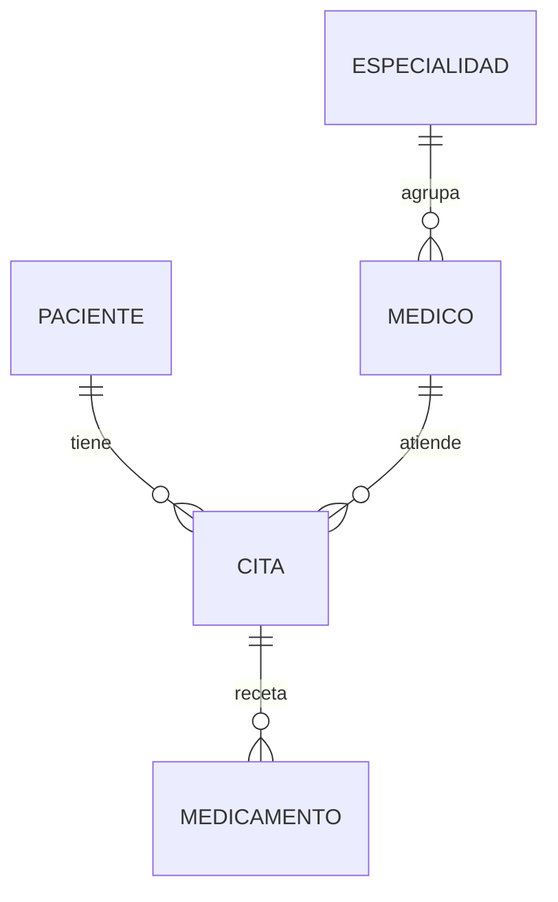

# 2026-10-30 — Normalización 1FN y 2FN: base de datos de hospital

## Contexto y fuente

Clase de Back End, semana 10. Material: **“Semana 10 · Primera y Segunda Forma Normal”** (13 páginas, docente Barry), especialmente páginas 4–5 (1FN), 6–7 (Actividad 1), 8–10 (2FN), 12–13 (Actividad 2 y entrega).

**Estado:** conceptos estudiados y práctica realizada en MySQL Workbench según la conversación y las capturas compartidas. No equivale a una evaluación docente ni acredita el cumplimiento total de cada punto de la guía. [Registro de práctica](../practicas/10-normalizacion-hospital.md).

## Qué aprendí

- **Normalizar** organiza los datos según sus dependencias para reducir redundancia y anomalías de inserción, actualización y eliminación. No consiste solamente en crear muchas tablas.
- **Clave primaria (PK):** identifica cada fila de manera única y no nula. **Clave foránea (FK):** declara una referencia a la clave de otra tabla e impone integridad referencial para valores no nulos.
- **Clave compuesta:** usa dos o más columnas como identificador. **Dependencia funcional** `A → B`: cada valor de A determina un único valor de B.
- **Primera forma normal (1FN):** cada celda tiene un valor atómico, sin listas separadas por comas ni grupos repetitivos, y cada fila dispone de clave primaria.
- **Segunda forma normal (2FN):** exige estar en 1FN y que cada atributo no clave dependa de **toda** la clave primaria, sin dependencias parciales de una clave compuesta.
- Si la PK tiene **una sola columna** y la tabla cumple 1FN, no hay dependencia parcial de una PK compuesta: la tabla ya cumple 2FN. Esto no prueba automáticamente 3FN ni un modelo de negocio óptimo.

## Recorrido del hospital observado

1. Se creó la base `hospital` y la tabla inicial `registro_hospital`, que mezclaba paciente, médico, especialidad, cita y medicamentos. La primera consulta mostró **4 registros**. Algunos pacientes, médicos y especialidades estaban repetidos, y dos celdas contenían listas de medicamentos.
2. Se crearon por separado las tablas `paciente`, `medico`, `especialidad`, `cita` y `medicamento`. Se copiaron los datos de la tabla original y se definieron PK individuales.
3. Se declararon y verificaron **4 FK**: `medico.id_especialidad → especialidad.id_especialidad`, `cita.id_paciente → paciente.id_paciente`, `cita.id_medico → medico.id_medico` y `medicamento.id_cita → cita.id_cita`.
4. Para eliminar las listas en celdas, se separaron los medicamentos de dos citas en filas individuales. El resultado observado fue **6 filas** en `medicamento`. La consulta `JOIN` final mostró **6 filas** con paciente, médico, especialidad, cita, medicamento e indicaciones.
5. Se generó un **diagrama EER en Workbench** mediante ingeniería inversa, se ocultó del diagrama la tabla plana original y se guardó el modelo localmente. También se creó durante la conversación un diagrama explicativo de 2FN; no se incorporaron estos archivos gráficos al repositorio.
6. La consulta a `information_schema.KEY_COLUMN_USAGE` devolvió **5 tablas con una sola columna en la PK**. Con los datos atómicos observados, no se identificaron dependencias parciales de claves compuestas.

## Dependencias funcionales del modelo practicado

| Tabla | Dependencia de la clave |
|---|---|
| `paciente` | `id_paciente → nombre, telefono, edad` |
| `medico` | `id_medico → nombre, telefono, id_especialidad` |
| `especialidad` | `id_especialidad → nombre` |
| `cita` | `id_cita → id_paciente, id_medico, fecha, hora, motivo` |
| `medicamento` | `id_medicamento → id_cita, nombre, indicaciones` |

Este esquema registra **medicamentos recetados por cita** como filas individuales. El identificador `id_medicamento` de esta práctica es el de la fila de prescripción, no necesariamente el de un medicamento único de catálogo. Por tanto, las tablas actuales **no representan explícitamente una relación N:M** entre un catálogo independiente de medicamentos y las citas.

## Relaciones del diagrama practicado

La tabla `registro_hospital` sirvió como punto de partida para comparar el estado sin normalizar, pero **no forma parte del diagrama relacional final**.

## Distinción importante entre práctica y requisitos de la guía

La página 7 pide **al menos cinco atributos por entidad, cinco filas en la tabla plana, un atributo multivaluado y una relación muchos a muchos**. Las capturas de esta sesión acreditan cuatro filas iniciales, cinco tablas con menos de cinco atributos en varias de ellas, un atributo multivaluado inicial y medicamentos por cita resueltos como relación 1:N. Por tanto, **no se debe presentar como una entrega que cumple íntegramente esos requisitos**.

La página 12 invita a buscar claves compuestas (por ejemplo, en una unión Cita–Medicamento). En nuestro esquema final las cinco PK son simples: la comprobación de 2FN fue **por ausencia de dependencias parciales**, no por descomposición de una tabla con clave compuesta. Si se exigiera ilustrar este segundo caso, habría que estudiar otro diseño; no se documenta como ejecutado.

## Qué no se hizo

- No se registró una conversión completa del modelo a 3FN ni una demostración formal de 3FN.
- No consta la normalización escrita a mano ni la entrega/aprobación final del profesor.
- No se migró Vértice CR a MySQL ni se añadió código del hospital a la aplicación.

## Utilidad futura

Antes de diseñar catálogos, órdenes o cotizaciones de Vértice, identificar entidades, claves y dependencias; evitar listas de valores en celdas; y decidir si una relación es 1:N o N:M en lugar de asumirlo solo porque varios nombres se repiten. Todo cambio de datos estructurales debe acompañarse de consultas de verificación y, cuando proceda, diagramas EER.
